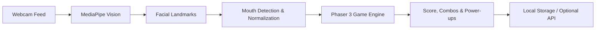
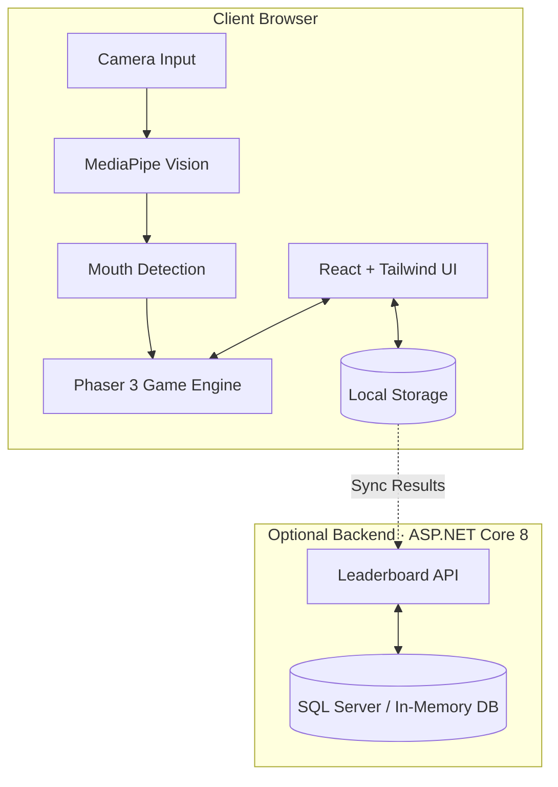
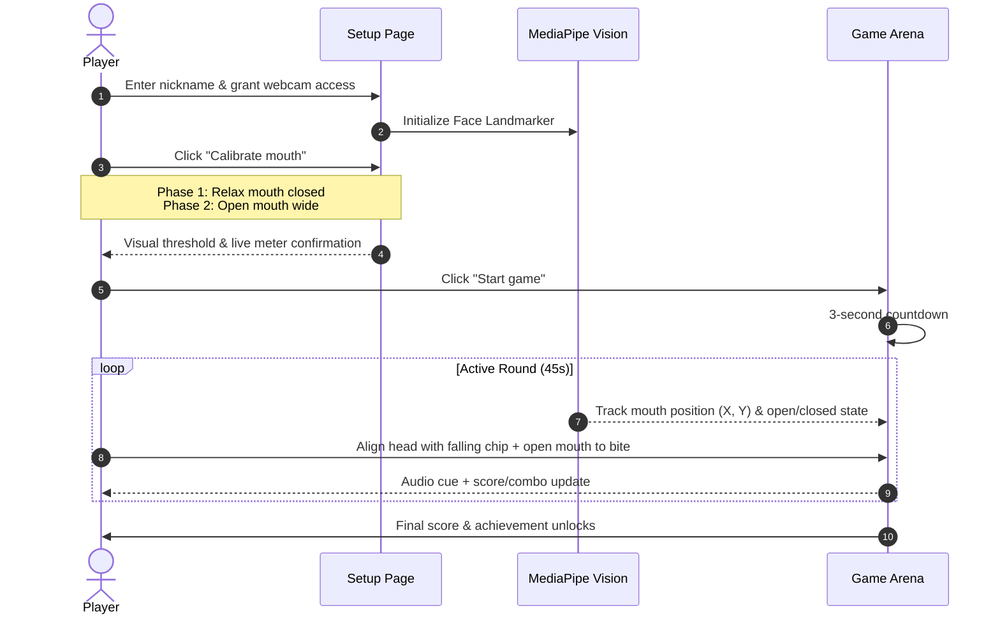

<h1 align="center">Chip Bite Challenge</h1>

An interactive, webcam-driven arcade game where your face and mouth movements control gameplay in real-time.

[](https://reactjs.org/)
[](https://vitejs.dev/)
[](https://phaser.io/)
[](https://developers.google.com/mediapipe)
[](https://vitest.dev/)

---

**Chip Bite Challenge** transforms physical head and mouth gestures into arcade mechanics. Players use head positioning to align with falling virtual chips and open their mouth to "bite" them.

All facial landmark detection occurs **100% locally in your browser** via MediaPipe Tasks Vision. Video frames are never recorded or sent over the network.



---

## Features

- **Gesture-Based Gameplay**: Move your head left/right to aim; open your mouth to bite.
- **Privacy First**: Video frames and facial landmarks stay completely inside client browser memory.
- **Tilt-Resistant Tracking**: Normalizes mouth openness against lip width to prevent false triggers when tilting head up.
- **Live Calibration Meter**: Real-time openness gauge with visual bite threshold indicator before entering the arena.
- **Dynamic Chip Mechanics**:
  - **Normal & Golden Chips**: Standard points and high-value multipliers.
  - **Speed & Combo Chips**: Multipliers and streak boosters.
  - **Frozen Chips**: Slows down game tempo.
  - **Bombs**: Penalties and combo breakers to dodge.
  - **Power-Ups**: Magnet, shield, double score, and extra time.
- **Local-First Persistence**: Instant local leaderboard, profiles, and achievement unlocks.
- **Connected Mode (Optional)**: ASP.NET Core 8 Web API with SQL Server / in-memory fallback for college-fest kiosks.

---

## Architecture



---

## Quick Start

### Prerequisites
- **Node.js**: v18+ (tested on Node 20 / 24)
- **Modern Browser**: Chrome, Edge, Brave, or Firefox with webcam permission support

### 1. Installation

```bash
# Install frontend dependencies from root
npm install --prefix frontend
```

### 2. Configure Environment

Copy the example environment file:

```bash
# Windows PowerShell:
Copy-Item frontend/.env.example frontend/.env

# macOS / Linux:
cp frontend/.env.example frontend/.env
```

### 3. Start Development Server

```bash
npm run dev
```
Open [http://localhost:5173](http://localhost:5173) in your browser.

---

## How to Play



---

## Testing & Verification

```bash
# Run unit & integration tests
npm test

# Run TypeScript check & production build
npm run build

# Run linter
npm run lint
```

---

## Connected Backend (Optional)

The backend is completely optional. If you want to run the ASP.NET Core API for centralized tournament leaderboards:

### Prerequisites
- [.NET 8 SDK](https://dotnet.microsoft.com/download/dotnet/8.0)

### Run API
```bash
dotnet run --project backend/ChipBiteChallenge.API --urls http://localhost:5080
```

- Swagger UI available at `http://localhost:5080/swagger`
- Health check available at `http://localhost:5080/api/health`

---

## Privacy & Performance Notes

- **Zero Video Uploads**: Camera streams are piped into a hidden HTML `<video>` element and evaluated in-memory using WebGL/WebGPU shaders. No images are sent to any remote servers.
- **Offline Model Support**: By default, MediaPipe models load from Google's CDN. For offline events, place `face_landmarker.task` in `frontend/public/` and configure `VITE_FACE_LANDMARKER_MODEL_URL` in `.env`.

## Info
- Made for IDEAS 4.0 by Krish Kumar & Prabhat Bhatia