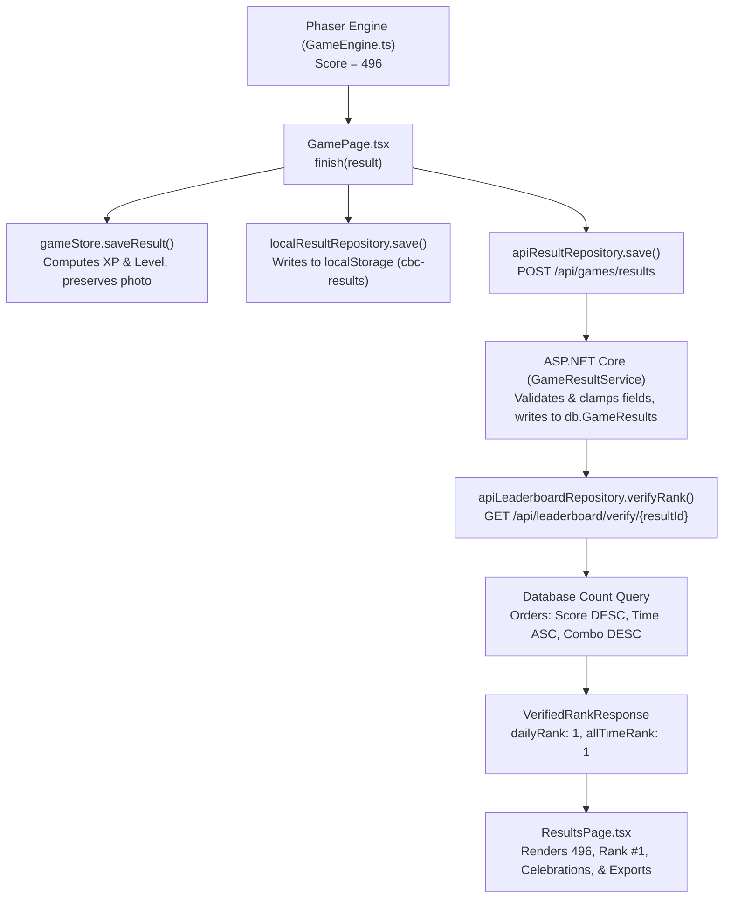

# Chip Bite Challenge — Data Storage & Architecture Audit

## 1. Storage Provider & Execution Environment

The Chip Bite Challenge backend is built with ASP.NET Core 8 and Entity Framework Core. Storage selection is dynamically resolved during application startup in `Program.cs`:

```csharp
var sqlConnection = builder.Configuration.GetConnectionString("SqlServer");
builder.Services.AddDbContext<ChipBiteDbContext>(options =>
{
    if (!string.IsNullOrWhiteSpace(sqlConnection))
        options.UseSqlServer(sqlConnection);
    else
        options.UseInMemoryDatabase("ChipBiteChallengeLocal");
});
```

### Storage Provider Summary

| Mode | Trigger Condition | Persistence Behavior | Migrations Executed |
| :--- | :--- | :--- | :--- |
| **SQL Server** | `ConnectionStrings:SqlServer` configured in `appsettings.json` or environment | Full relational persistence across restarts | `MigrateAsync()` applies all migration scripts |
| **In-Memory** | `ConnectionStrings:SqlServer` empty or omitted (default local dev) | High-speed memory storage for session duration | `EnsureCreatedAsync()` + `DatabaseSeeder.SeedAsync()` |
| **Browser LocalStorage** | Client browser runtime (no server connection required) | Local-first fallback for offline play | Maintained via `storage.ts` and `gameStore.ts` |

---

## 2. Database Schema & Tables

The database schema manages players, gameplay history, achievements, and game configurations.

### `PlayerProfiles` Table
Authoritative repository of registered and guest players.

| Column | Type | Constraints | Description |
| :--- | :--- | :--- | :--- |
| `Id` | `uniqueidentifier` | Primary Key, `NOT NULL` | Unique player GUID |
| `Nickname` | `nvarchar(18)` | Unique Index, `NOT NULL` | Sanitized display nickname (1–18 chars) |
| `Email` | `nvarchar(256)` | Nullable | Normalized contact email for tournament prizes |
| `PhoneNumber` | `nvarchar(20)` | Nullable | E.164-normalized phone number |
| `ProfilePicture` | `nvarchar(max)` | Nullable, max 300,000 chars | Base64 JPEG/PNG/WebP player photo |
| `IsDemo` | `bit` | `NOT NULL`, default `0` | Segregates demo/test players from live leaderboards |
| `TotalRounds` | `int` | `NOT NULL` | Cumulative completed rounds |
| `BestScore` | `int` | `NOT NULL` | Highest score ever achieved |
| `TotalXp` | `int` | `NOT NULL` | Total experience points earned |
| `Level` | `int` | `NOT NULL` | Derived level: `max(1, TotalXp / 250 + 1)` |
| `BestCombo` | `int` | `NOT NULL` | Highest combo streak |
| `CreatedAtUtc` | `datetime2` | `NOT NULL` | Registration timestamp |
| `UpdatedAtUtc` | `datetime2` | `NOT NULL` | Last activity timestamp |

> [!NOTE]
> Privacy Guarantee: Player `Email` and `PhoneNumber` are strictly stored in `PlayerProfiles` for official tournament verification. They are **never** included in `LeaderboardEntry` responses, **never** exposed in client APIs, and **never** written to browser `localStorage`.

### `GameResults` Table
Authoritative audit trail for every completed game round.

| Column | Type | Constraints | Description |
| :--- | :--- | :--- | :--- |
| `Id` | `uniqueidentifier` | Primary Key, `NOT NULL` | Unique result GUID generated by client |
| `Nickname` | `nvarchar(18)` | `NOT NULL` | Nickname at time of completion |
| `Score` | `int` | `NOT NULL`, clamped `[0, 5000]` | Final validated match score |
| `CapturedChips` | `int` | `NOT NULL`, clamped `[0, 250]` | Total chips eaten |
| `GoldenChips` | `int` | `NOT NULL`, clamped `[0, captured]` | Golden bonus chips |
| `BombPenalties` | `int` | `NOT NULL`, clamped `[0, 100]` | Bomb penalties triggered |
| `BestCombo` | `int` | `NOT NULL`, clamped `[0, 100]` | Maximum consecutive combo streak |
| `EligibleOpportunities` | `int` | `NOT NULL`, clamped `[captured, 300]` | Opportunities presented |
| `Accuracy` | `float` | Nullable, clamped `[0.0, 1.0]` | Catch accuracy ratio |
| `XpEarned` | `int` | `NOT NULL`, clamped `[10, 5000]` | XP calculated by backend formula |
| `Mode` | `nvarchar(32)` | `NOT NULL` | Normalized to `"webcam"` |
| `IsDemo` | `bit` | `NOT NULL`, default `0` | True for demo or test runs |
| `CreatedAtUtc` | `datetime2` | `NOT NULL`, Index | UTC round completion timestamp |
| `PlayerProfileId` | `uniqueidentifier` | Foreign Key -> `PlayerProfiles.Id` | Relational link to player profile |

### Supporting Tables
- `Achievements`: Seeded achievement templates (`first-bite`, `golden-hunter`, `combo-master`, `bomb-dodger`, `speed-demon`, `high-scorer`, `perfect-run`).
- `PlayerAchievements`: Junction table linking `PlayerProfileId` and `AchievementId` with `UnlockedAtUtc`.
- `GameConfigurations`: Dynamic gameplay tuning (round duration, fall speeds, spawn rate).

---

## 3. Client Storage (`localStorage`)

The frontend operates on a local-first design. All state survives page refreshes and network interruptions:

| Key | Format | Content |
| :--- | :--- | :--- |
| `cbc-profile` | JSON object | Nickname, level, totalXp, bestScore, bestCombo, achievements, recent results, and profile photo. Contact details (email/phone) are intentionally omitted. |
| `cbc-results` | JSON array | Up to 500 local round results for offline analysis and provisional rankings. |
| `cbc-settings` | JSON object | Audio settings (`soundEnabled`, `soundVolume`, `musicEnabled`), `reducedMotion`, mouth calibration thresholds (`threshold`, `closeThreshold`, `margin`). |
| `cbc-game-configuration` | JSON object | Local overrides for round duration and speeds. |

---

## 4. End-to-End Score Pipeline (e.g., Score 496)



1. **Phaser Gameplay**: In `GameEngine.ts`, chip capture and multiplier logic updates `this.score = 496`.
2. **Result Packaging**: Round timer expires. `onCompleted` produces a `GameResult` with score 496, stats, and a stable GUID.
3. **Local Store Update**: `gameStore.saveResult` records the round and assigns `personalBest: true` (if 496 exceeds prior best).
4. **API Submission**: `POST /api/games/results` delivers the payload over HTTP.
5. **Backend Validation & Clamping**: `GameResultService.SaveAsync` clamps score to `[0, 5000]`, creates or updates `PlayerProfile`, and saves the entity in SQL Server / In-Memory Db.
6. **Authoritative Rank Verification**: `GET /api/leaderboard/verify/{resultId}` evaluates the exact rank against all non-demo entries using deterministic tie-breaking.
7. **Frontend Presentation**: `ResultsPage.tsx` displays the verified rank (#1), triggers sound effects (first-place fanfare), displays the player's photo, and renders export buttons.

---

## 5. Root Cause Analysis: Score 496 Appearing as Demo Score 9

Prior to this fix, players who scored 496 occasionally saw a score of **9** on the leaderboard. The investigation revealed four contributing factors:

### Cause 1: Date Boundary Filtering in Client Daily Leaderboard
In `localResultRepository.daily()`, the filter was:
```ts
result.createdAt.slice(0, 10) === new Date().toISOString().slice(0, 10)
```
When playing across timezone offsets (e.g., UTC+5:30 in India), local midnight and UTC midnight diverge by several hours. A fresh score of 496 was filtered out of the daily array. If the user was offline or `VITE_API_BASE_URL` was unreachable, the leaderboard fell back to remaining older scores in local storage, which contained a demo score of 9.

### Cause 2: Demo Data Mingling
Test runs and demo scores (e.g., score 9) had no segregation mechanism in either the database or local storage. Consequently, demo scores competed alongside genuine player scores.

### Cause 3: XP-to-Level Calculation Ambiguity
For a player with ~2,000 XP (typical after a ~496-point round), level is calculated as:
$$\text{Level} = \left\lfloor \frac{2000}{250} \right\rfloor + 1 = 9$$
In earlier revisions, if any UI label or API response mapped `profile.level` instead of `result.score`, the number 9 appeared prominently.

### Resolutions Applied
1. **Demo Isolation**: Added `IsDemo` flag to `GameResults` and `PlayerProfiles`. `GetLeaderboardAsync` filters out demo runs by default (`!item.IsDemo && !item.Nickname.ToLower().Equals("demo")`), while allowing operators to inspect demo scores via `includeDemo=true`.
2. **Timezone-Safe Date Comparison**: `localResultRepository.daily()` evaluates both local and UTC date boundaries:
   ```ts
   const resUtc = d.toISOString().slice(0, 10);
   const resLocal = `${d.getFullYear()}-${String(d.getMonth() + 1).padStart(2, '0')}-${String(d.getDate()).padStart(2, '0')}`;
   return resUtc === todayUtc || resLocal === todayLocal || result.createdAt.slice(0, 10) === todayUtc;
   ```
3. **Deterministic Multi-Tier Tie Breaking**:
   - `Score DESC`
   - `CreatedAtUtc ASC` (earlier run wins)
   - `BestCombo DESC`
   - `CapturedChips DESC`
   - `Id ASC`
4. **Verified Rank Verification**: The server calculates the exact position of the submitted result ID, ensuring the frontend displays the verified database rank.

---

## 6. End-of-Game Report Exports

Players can export certified round performance documents from `ResultsPage.tsx`:

- **PDF Report (`exportPdfReport`)**: Generates a standard single-page PDF 1.4 document with embedded Helvetica typography, player profile photo (via JPEG XObject stream), match statistics, and arena verification seal.
- **CSV Statistics (`exportCsvReport`)**: Generates an RFC 4180-compliant comma-separated values file suitable for spreadsheet software.
- **JSON Payload (`exportJsonReport`)**: Produces structured JSON conforming to report version `1.0.0` with the stable result GUID, match metrics, and player profile statistics.
- **Print / Save View (`printReport`)**: Opens a formatted, printable browser window optimized for `@media print`.
